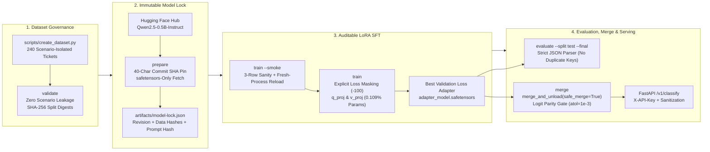

<div align="center">

# LoraForge AI

**Auditable LoRA Fine-Tuning, Cryptographic Provenance Verification & Standalone Model Export Pipeline**

*Built by **[IntelligentStack AI](https://github.com/raklabs)** (`@raklabs`) — Production-Grade Applied AI Engineering*

[](https://github.com/raklabs/loraforge-ai/actions/workflows/ci.yml)
[](https://www.python.org/)
[](https://huggingface.co/Qwen/Qwen2.5-0.5B-Instruct)
[](SECURITY.md)
[](LICENSE)

</div>

---

## Executive Summary

Most fine-tuning repositories hide critical failure modes behind high-level trainer wrappers: **silent sequence truncation**, **prompt-token supervision leakage**, **unpinned base-model revisions**, **scenario overlap between train and test splits**, and **unverified adapter merges**.

**LoraForge AI** is a glass-box, cryptographically auditable **Low-Rank Adaptation (LoRA)** supervised fine-tuning (SFT), evaluation, standalone weight-merging, and FastAPI inference pipeline engineered by **IntelligentStack AI**. It adapts `Qwen/Qwen2.5-0.5B-Instruct` (`494.57M` parameters) on CPU in `float32` by training only **`540,672` parameters (`0.1093%`)** on `q_proj` and `v_proj` attention projections—boosting strict-schema support-ticket classification accuracy from **`22.5%` to `80.0%` (`+57.5 percentage points`)** on a scenario-isolated held-out test set.

### Empirical Benchmark Snapshot (`Qwen/Qwen2.5-0.5B-Instruct`)

| Metric / Category | Frozen Base Model (`7ae55760...`) | LoraForge LoRA Adapter (`r=8, α=16`) | Absolute Gain |
| :--- | :---: | :---: | :---: |
| **Strict JSON Schema Validity** | `40 / 40` (`100.0%`) | `40 / 40` (`100.0%`) | `0.0 pp` (Preserved) |
| **Overall Held-Out Test Accuracy** | **`9 / 40` (`22.5%`)** | **`32 / 40` (`80.0%`)** | **`+57.5 pp`** |
| `billing` Accuracy | `1 / 10` (`10.0%`) | `7 / 10` (`70.0%`) | **`+60.0 pp`** |
| `account` Accuracy | `0 / 10` (`0.0%`) | `8 / 10` (`80.0%`) | **`+80.0 pp`** |
| `technical` Accuracy | `0 / 10` (`0.0%`) | `9 / 10` (`90.0%`) | **`+90.0 pp`** |
| `other` Accuracy | `8 / 10` (`80.0%`) | `8 / 10` (`80.0%`) | `0.0 pp` |

> 📄 See the full empirical study, training loss curve (`0.3953 -> 0.0020`), validation loss trajectory (`0.1194 -> 0.0765`), standalone merge logit parity verification (`2.079e-4` max absolute difference), and root-cause analysis of remaining failure modes in **[`docs/BENCHMARK_REPORT.md`](docs/BENCHMARK_REPORT.md)**.

---

## System Architecture & Verification Gates

Every stage of the LoraForge AI lifecycle is gated by cryptographic SHA-256 locks and deterministic invariants defined in [`CONSTITUTION.md`](CONSTITUTION.md) and [`specs/001-reproducible-lora-sft.md`](specs/001-reproducible-lora-sft.md):



---

## Key Engineering Highlights

### 1. Explicit Assistant-Only Cross-Entropy Loss Masking
High-level SFT wrappers frequently supervise user prompt tokens by mistake or silently truncate sequences when `max_length` is exceeded. LoraForge AI verifies chat-template prefix alignment and masks every system and user token with `-100`:

```python
prompt = tokenizer.apply_chat_template(messages(row["text"]), tokenize=True, add_generation_prompt=True)
full = tokenizer.apply_chat_template(messages(row["text"], row["category"]), tokenize=True, add_generation_prompt=False)
if full[:len(prompt)] != prompt:
    raise ValueError("Chat template prefix mismatch; cannot safely mask assistant tokens")
if len(full) > max_length:
    raise ValueError(f"{row['id']}: {len(full)} tokens exceed {max_length}; shorten example, never truncate target")
return {"input_ids": full, "labels": [-100] * len(prompt) + full[len(prompt):]}
```

For `Qwen/Qwen2.5-0.5B-Instruct`, only the **7 assistant target tokens** (`{"category":"<label>"}<|im_end|>\n`) contribute to the cross-entropy gradient.

### 2. Scenario-Isolated Dataset Governance
Paraphrased support tickets can easily leak across random train/test splits. [`scripts/create_dataset.py`](scripts/create_dataset.py) constructs 120 distinct support scenarios (2 paraphrases per scenario = 240 tickets) and assigns entire scenarios to splits (`train`: scenarios `01–20`, `validation`: `21–25`, `test`: `26–30`). [`loraforge/core.py`](loraforge/core.py) rejects any dataset where a `scenario_id` crosses split boundaries.

### 3. Mathematically Verified Standalone Model Export (`merge`)
Deploying PEFT adapters in production often introduces runtime coupling to the base snapshot and PEFT version. The `merge` command folds the trained low-rank matrices into the base weights:

$$W_{\text{merged}} = W_0 + \frac{\alpha}{r} B A$$

Before exporting `artifacts/merged-model/`, LoraForge AI enforces three verification gates:
1. **NaN/Inf Rejection**: `merge_and_unload(safe_merge=True)` plus explicit `torch.isfinite` checks.
2. **Last-Token Logit Parity**: Asserts `torch.testing.assert_close(actual_logits, expected_logits, rtol=1e-4, atol=1e-3)` across all `151,936` vocabulary tokens (empirical max difference: `2.079e-4`).
3. **Subprocess Cold-Start Reload**: Spawns a fresh Python process that loads `artifacts/merged-model/` **without** `peft` or the base snapshot and verifies byte-for-byte identical generation.

### 4. Hardened FastAPI Inference Microservice
[`loraforge/serve.py`](loraforge/serve.py) exposes the classifier via a production FastAPI microservice featuring:
- **Control-Character Sanitization**: Strips non-printable ASCII control bytes (`0x00–0x1F`, `0x7F`) before prompt templating.
- **Strict Pydantic Validation**: Enforces `extra="forbid"`, length bounds (`1..1000` chars), and structured response schemas.
- **Constant-Time API Key Auth**: Optional `X-API-Key` authentication using `hmac.compare_digest`.
- **Security Headers**: Attaches `X-Content-Type-Options: nosniff`, `X-Frame-Options: DENY`, `Content-Security-Policy: default-src 'none'`, and `Cache-Control: no-store`.

---

## Repository Structure

```text
loraforge-ai/
├── CONSTITUTION.md                  # Non-negotiable ML & software engineering invariants
├── SECURITY.md                      # OWASP LLM Top 10 & ML supply-chain controls
├── config.json                      # Frozen experiment & LoRA hyperparameters
├── pyproject.toml                   # Package metadata, CLI entry point, ruff & pytest config
├── requirements.txt                 # Pinned reproducible CPU dependency manifest
├── specs/
│   └── 001-reproducible-lora-sft.md # Formal specification & acceptance criteria (AC-1..AC-6)
├── docs/
│   └── BENCHMARK_REPORT.md          # Complete empirical study (+57.5 pp gain & error analysis)
├── data/
│   ├── README.md                    # Dataset provenance, SHA-256 hashes & leakage policy
│   ├── train.jsonl                  # 160 training tickets (scenarios 01-20)
│   ├── validation.jsonl             # 40 validation tickets (scenarios 21-25)
│   └── test.jsonl                   # 40 held-out test tickets (scenarios 26-30)
├── loraforge/
│   ├── __init__.py                  # Public package exports
│   ├── core.py                      # Auditable SFT loop, evaluator, lock manager & merge verifier
│   ├── serve.py                     # FastAPI inference microservice (/healthz, /v1/classify)
│   └── cli.py                       # `loraforge` CLI entry point
├── scripts/
│   ├── create_dataset.py            # Deterministic scenario-isolated dataset generator
│   └── poc.py                       # Backward-compatible CLI runner
└── tests/
    └── test_loraforge.py            # 23 unit, API security & offline Qwen2 LoRA integration tests
```

---

## Quickstart

### 1. Environment Setup

```bash
python3.11 -m venv .venv
source .venv/bin/activate
python -m pip install --upgrade pip
pip install -r requirements.txt
pip install --no-deps -e .
```

### 2. Verify Dataset Integrity, Runtime & Test Suite

Run the offline verification suite (executes in `< 3 seconds` with zero network calls):

```bash
# Validate dataset schema, class balance, and scenario isolation
python scripts/poc.py validate

# Verify Python runtime, pinned library versions, and CPU autograd
python scripts/poc.py doctor

# Run all 23 unit, API security, and tiny Qwen2 LoRA integration tests
pytest -v
```

### 3. Run the Full Auditable Fine-Tuning Pipeline

```bash
# 1. Pin immutable 40-char HF commit SHA and download safetensors weights
python scripts/poc.py prepare

# 2. Evaluate frozen baseline model on validation and held-out test splits
python scripts/poc.py evaluate --split validation
python scripts/poc.py evaluate --split test --final

# 3. Run 3-example smoke training + subprocess adapter reload verification
python scripts/poc.py train --smoke

# 4. Run full 3-epoch LoRA training (saves best validation-loss checkpoint)
python scripts/poc.py train

# 5. Evaluate trained LoRA adapter and generate audit report
python scripts/poc.py evaluate --split validation --adapter artifacts/train/adapter
python scripts/poc.py evaluate --split test --final --adapter artifacts/train/adapter
python scripts/poc.py report

# 6. Export standalone merged model with logit parity & fresh-process verification
python scripts/poc.py merge
```

### 4. Launch the FastAPI Inference Microservice

```bash
# Start the microservice (uses standalone merged model when --merged is passed)
python scripts/poc.py serve --merged artifacts/merged-model --host 127.0.0.1 --port 8000
```

Query the `/v1/classify` endpoint:

```bash
curl -s http://127.0.0.1:8000/v1/classify \
  -H "Content-Type: application/json" \
  -d '{"text": "My card was charged twice for the monthly subscription plan."}' | jq .
```

Example response:

```json
{
  "category": "billing",
  "raw_output": "{\"category\":\"billing\"}",
  "schema_valid": true,
  "model_variant": "merged:merged-model",
  "latency_ms": 412.6
}
```

---

## Security & Supply-Chain Controls

LoraForge AI enforces strict controls aligned with the **OWASP Top 10 for LLM Applications**:
- **Zero Pickle Execution**: All model and adapter checkpoints use `safetensors` (`use_safetensors=True`, `safe_serialization=True`).
- **Immutable 40-Character Revision Pinning**: `prepare` rejects branch names and short hashes, locking the exact Hugging Face commit SHA in `artifacts/model-lock.json`.
- **Cryptographic Dataset & Prompt Locking**: Any byte modification to `data/*.jsonl`, `config.json`, or the system prompt invalidates downstream evaluation and merge commands.
- **Strict Output Parser**: Rejects duplicate JSON keys (`{"category":"account","category":"billing"}`), extra properties, and markdown wrappers.

See **[`SECURITY.md`](SECURITY.md)** for full details.

---

## Built by IntelligentStack AI

Looking to integrate reliable, production-grade AI into your existing Python, FastAPI, Django, or TypeScript stack without hallucinations or vendor lock-in?  
Connect with **IntelligentStack AI** via [@raklabs](https://github.com/raklabs).

---

## License

Released under the [MIT License](LICENSE). Copyright © 2026 **IntelligentStack AI (`@raklabs`)**.
