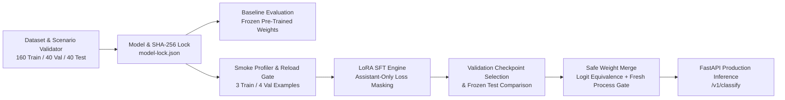

# Spec 001: Auditable LoRA Supervised Fine-Tuning & Standalone Export Pipeline

- **Status**: Approved & Empirically Verified · 2026-05-18
- **Project**: LoraForge AI (`loraforge-ai`) — IntelligentStack AI (`raklabs`)
- **Base Model**: `Qwen/Qwen2.5-0.5B-Instruct` (pinned commit `7ae557604adf67be50417f59c2c2f167def9a775`)
- **Adaptation Method**: Low-Rank Adaptation (LoRA, `r=8, alpha=16, dropout=0.05` on `q_proj, v_proj`)

---

## 1. Objective & Problem Statement

Organizations adopting Small Language Models (SLMs) for deterministic classification, routing, and structured JSON extraction need a fine-tuning pipeline that is **scientifically reproducible**, **cryptographically auditable**, **safe against data leakage**, and **verifiable upon standalone weight export**.

Standard notebook-based fine-tuning scripts suffer from:
1. **Unpinned base models & silent dataset drift** between baseline evaluation, training, and post-training evaluation.
2. **Paraphrase leakage across train/test splits** that artificially inflates benchmark scores.
3. **Full-sequence cross-entropy loss** that wastes adapter capacity modeling user prompt tokens rather than assistant output tokens.
4. **Unverified LoRA weight merging** where `merge_and_unload()` is assumed to match the PEFT adapter without checking numerical logit equivalence or standalone fresh-process generation.

---

## 2. Pipeline Architecture & Verification Lifecycle



---

## 3. Domain Task & Strict Output Contract

Given a single customer support ticket, the model must output **only** a strict JSON object with a single key `"category"`:

| Category | Scope Definition | Example |
| :--- | :--- | :--- |
| `billing` | Payments, invoices, refunds, subscription charges, tax, or seat billing | `{"category":"billing"}` |
| `account` | Login, password reset, MFA/2FA, profile changes, SSO, or workspace access | `{"category":"account"}` |
| `technical` | Product bugs, HTTP 500 errors, crashes, broken exports, or performance issues | `{"category":"technical"}` |
| `other` | General inquiries, partnership requests, or insufficient information | `{"category":"other"}` |

### Strict Output Parser Rules (`loraforge/evaluation.py`)
- Must parse via `json.loads(..., object_pairs_hook=unique_pairs)`.
- Duplicate keys (e.g., `{"category":"account","category":"billing"}`), markdown code fences (` ```json `), extra keys, trailing prose, or uppercase labels (`"BILLING"`) are rejected as `None` (invalid schema) and scored as incorrect.

---

## 4. Dataset & Split Isolation Contract (`loraforge/dataset.py`)

- **Total Dataset**: 240 curated tickets across 120 distinct scenarios (2 paraphrases per scenario):
  - `train.jsonl`: 160 examples (20 scenarios $\times$ 2 paraphrases $\times$ 4 categories)
  - `validation.jsonl`: 40 examples (5 scenarios $\times$ 2 paraphrases $\times$ 4 categories)
  - `test.jsonl`: 40 examples (5 scenarios $\times$ 2 paraphrases $\times$ 4 categories)
- **Zero Scenario Leakage**: Every scenario (`e.g. billing-01`) keeps both of its paraphrases inside the same split. Any cross-split `scenario_id` collision raises a `ValueError`.
- **Assistant-Only Token Masking**:
  - `prompt_ids = apply_chat_template([system, user], add_generation_prompt=True)`
  - `full_ids = apply_chat_template([system, user, assistant], add_generation_prompt=False)`
  - Invariant: `full_ids[:len(prompt_ids)] == prompt_ids`
  - Labels: `[-100] * len(prompt_ids) + full_ids[len(prompt_ids):]`

---

## 5. Standalone Merge & Numerical Equivalence Gate (`loraforge/engine.py`)

When exporting a standalone model (`merge_and_unload(safe_merge=True)`):
1. **Pre-condition**: Rejects smoke adapters, incomplete runs, or existing target directories.
2. **Numerical Logit Gate**: Computes next-token logits on a held-out validation example before and after folding LoRA matrices (`B @ A`) into base weights (`W`). Enforces `torch.testing.assert_close(actual, expected, rtol=1e-4, atol=1e-3, equal_nan=False)`.
3. **Fresh-Process Isolation Gate**: Spawns a clean Python subprocess that loads *only* the exported directory (`local_files_only=True`) without the base snapshot or PEFT adapter, verifying identical greedy output.

---

## 6. Acceptance Criteria

- **AC-1**: Dataset loader enforces exact split sizes (`160/40/40`), class balance, duplicate text rejection, and `scenario_id` split isolation.
- **AC-2**: Token encoder masks all prompt tokens with `-100`, supervises only assistant response tokens, and rejects any example that would truncate.
- **AC-3**: Strict JSON evaluator rejects markdown wrappers, extra keys, and duplicate keys (`unique_pairs`).
- **AC-4**: Report generator cryptographically verifies matching `model_id`, `revision`, `data_hashes`, `system_prompt_sha256`, and `adapter_sha256` across baseline, training, and adapted runs.
- **AC-5**: Standalone LoRA merge verifies float32 logit equivalence (`max_diff <= 1e-3`) and fresh-process reload.
- **AC-6**: FastAPI inference service (`/v1/classify`) authenticates requests, sanitizes control characters, and returns structured predictions.

